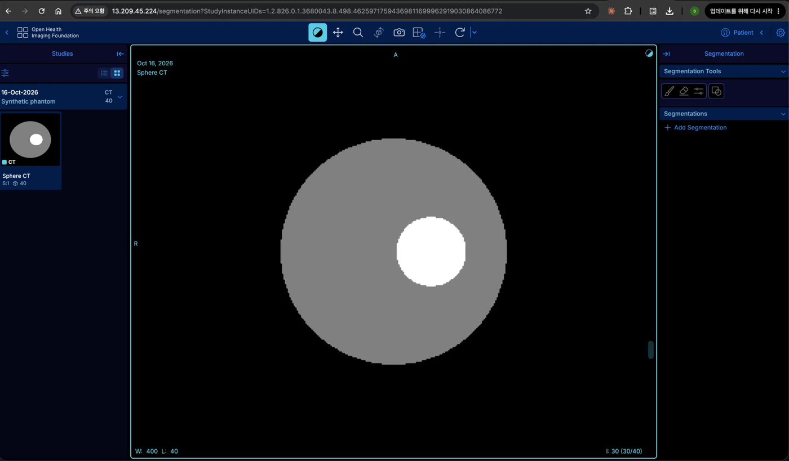
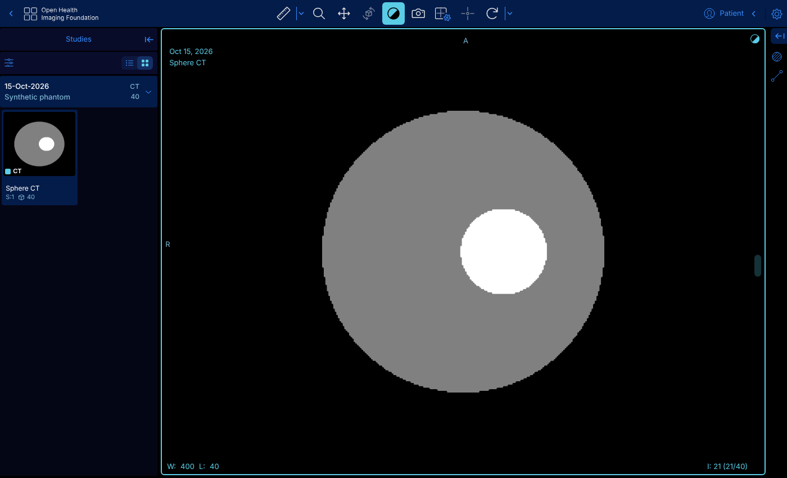

# Mini PACS on AWS — Orthanc + OHIF

EC2 한 대에 **Orthanc**(DICOM 서버, DICOMweb)와 **OHIF Viewer v3**를 Docker Compose로 올리는 미니 프로젝트입니다.
인프라는 Terraform으로 만듭니다.

```
 브라우저 ──HTTP:80──▶ [EC2 · Amazon Linux 2023]
 (내 IP만 허용)          nginx (basic auth)
                          ├─ /          ─▶ ohif     (OHIF Viewer 정적 앱)
                          └─ /orthanc/  ─▶ orthanc  (REST, DICOMweb, Orthanc Explorer 2)
                                                └─ docker volume → EBS gp3 (암호화)
 관리자 접속: SSM Session Manager (SSH 키/22번 포트 없음)
 basic auth 비밀번호: SSM Parameter Store (SecureString)
```

OHIF와 Orthanc가 같은 origin(`/`, `/orthanc/`) 아래에 있으므로 CORS 설정이 필요 없습니다.

## AWS 배포 결과

2026-10-15, 서울 리전(`ap-northeast-2`)에 `terraform apply` 한 번으로 리소스 8개를 만들고, 합성 CT 40장을 올려 EC2 공인 IP로 직접 확인했습니다.



| 항목 | 결과 |
|---|---|
| 생성 리소스 | 보안그룹, IAM 역할·정책 3개, 인스턴스 프로파일, Parameter Store, EC2(t3.small), Elastic IP |
| `apply` 소요 시간 | 약 30초 (EC2 생성 15초) |
| 부트스트랩 (Docker 설치 → 이미지 pull → 기동) | 수 분 (`/healthz` 응답으로 확인) |
| 확인한 것 | 내 IP만 접속, basic auth 로그인, DICOMweb 업로드 40/40, OHIF 썸네일·슬라이스 렌더링 |
| 정리 | 확인 후 `terraform destroy`로 리소스 8개 삭제 |

주소창의 "주의 요함"은 HTTP라서 표시됩니다. HTTPS는 아래 [다음 단계](#다음-단계-아이디어)에 있습니다.

## 구성 파일

| 경로 | 내용 |
|---|---|
| `docker/docker-compose.yml` | orthanc, ohif, nginx 3개 서비스 |
| `docker/nginx/default.conf` | 리버스 프록시 + basic auth, `/healthz` |
| `docker/ohif/app-config.js` | OHIF 데이터소스 → `/orthanc/dicom-web` |
| `docker/ohif/nginx.conf.template` | OHIF 이미지 내장 nginx 설정 교체 (IPv6 없는 호스트에서 크래시 방지) |
| `terraform/` | 보안그룹, IAM(SSM), Parameter Store, EC2, EIP |
| `scripts/make_sample_dicom.py` | 테스트용 합성 CT(구 팬텀) 생성 — 실제 환자 데이터 불필요 |
| `scripts/upload.sh` | 폴더의 `.dcm`을 Orthanc에 업로드 |

## 1. 로컬에서 실행 (Docker만 있으면 됨)

필요한 것: Docker Desktop(실행 중), 디스크 여유 약 3GB(Orthanc 이미지가 큼).
Windows는 **Git Bash** 또는 **WSL** 터미널에서 실행하세요.

```bash
./scripts/run-local.sh          # 시작 → 주소와 로그인 정보 출력 (첫 실행은 이미지 다운로드로 몇 분 소요)
./scripts/run-local.sh sample   # 합성 CT 40장 생성 후 업로드
./scripts/run-local.sh down     # 중지 (데이터 유지)
./scripts/run-local.sh reset    # 중지 + 저장된 DICOM 전부 삭제 + 비밀번호 재생성
```

- OHIF: http://localhost:8080 · Orthanc Explorer 2: http://localhost:8080/orthanc/ui/app/
- 로그인: `admin` / 자동 생성 비밀번호 (`docker/.local-password`에 저장). `PACS_PASSWORD=... ./scripts/run-local.sh`로 지정 가능
- 8080이 사용 중이면 `HTTP_PORT=8090 ./scripts/run-local.sh`
- 내 DICOM 파일은 OHIF의 **Upload** 버튼이나 Orthanc Explorer 2에서 드래그&드롭으로 올릴 수 있습니다



## 2. AWS에 배포

사전 준비
- AWS 계정: 루트 MFA, 유효한 결제 수단, 예산 알림(예: $5)
- IAM 사용자 액세스 키로 `aws configure` → `aws sts get-caller-identity`의 Arn이 `user/...`인지 확인 (루트 키 사용 금지)
- Terraform ≥ 1.5 (macOS: `brew install hashicorp/tap/terraform`)

```bash
cd terraform

# 내 IP만 허용하고 비밀번호는 무작위로 생성
MYIP=$(curl -s https://checkip.amazonaws.com)
PW=$(openssl rand -base64 18 | tr -d '/+=')
cat > terraform.tfvars <<EOF
region              = "ap-northeast-2"
allowed_cidrs       = ["${MYIP}/32"]
basic_auth_user     = "admin"
basic_auth_password = "${PW}"
EOF
echo "로그인 비밀번호: ${PW}"; unset PW

terraform init
terraform plan     # Plan: 8 to add
terraform apply
```

`terraform.tfvars`와 `terraform.tfstate`에는 비밀번호가 평문으로 들어가므로 `.gitignore`로 제외되어 있습니다.

출력되는 `ohif_url`로 접속합니다. 부트스트랩(Docker 설치 + 이미지 pull)에 **3~5분** 정도 걸립니다.
준비될 때까지 기다리려면:

```bash
until curl -sf --max-time 5 http://$(terraform output -raw public_ip)/healthz; do echo waiting; sleep 15; done
```

서버 안의 진행 상황은:

```bash
$(terraform output -raw ssm_session_command)     # SSM으로 접속 (Session Manager 플러그인 필요)
sudo tail -f /var/log/pacs-bootstrap.log
sudo docker compose -f /opt/pacs/docker-compose.yml ps
```

샘플 데이터 생성과 업로드 (저장소 루트에서):

```bash
# 합성 CT 40장 생성 (Docker 사용, 또는 python3 -m venv 후 pydicom·numpy 설치)
docker run --rm -v "$PWD/scripts:/scripts:ro" -v "$PWD/sample-data:/out" python:3.12-slim \
  sh -c 'pip install -q pydicom numpy && python /scripts/make_sample_dicom.py /out'

PACS_URL=http://<public_ip> PACS_PASSWORD='<비밀번호>' ./scripts/upload.sh sample-data   # uploaded=40 failed=0
```

첫 슬라이스는 팬텀 바깥(공기)이라 검게 보입니다. 마우스 휠로 가운데(20번 근처)까지 내리면 보입니다.

OHIF 화면 상단의 **Upload** 버튼으로 브라우저에서 바로 올릴 수도 있습니다.

## 3. 정리 (비용 발생 중지)

```bash
terraform destroy
```

대략적인 비용(서울 리전, 온디맨드): t3.small ≈ $0.026/h, gp3 30GB ≈ $2.9/월, 실행 중인 인스턴스에 붙은 EIP/퍼블릭 IPv4 ≈ $0.005/h.
→ 하루 종일 켜두면 약 $0.8. 실습이 끝나면 꼭 destroy 하세요.

## 트러블슈팅 (실제로 겪은 문제)

| 증상 | 원인 | 해결 |
|---|---|---|
| `terraform plan`에서 `"ingress.0.description" doesn't comply with restrictions` | 보안그룹 규칙 설명에 AWS가 허용하지 않는 `>` 문자(`nginx -> OHIF`)를 사용. `terraform validate`는 통과하고 `plan`에서 처음 드러남 | 설명을 허용 문자만으로 변경 (`8cc64ab`) |
| OHIF 컨테이너가 `socket() [::]:80 failed (97: Address family not supported)`로 재시작 반복 | 공식 OHIF 이미지의 내장 nginx가 IPv6 주소도 listen. IPv6가 없는 호스트에서 기동 실패 | IPv4만 listen하는 설정(`docker/ohif/nginx.conf.template`)을 마운트해 교체 |
| 결제 기본 설정에 "만료된 결제 방법" 경고 | 오래된 계정의 카드 유효기간 만료. 그대로 리소스를 만들면 청구 실패로 서비스가 중단될 수 있음 | `apply` 전에 새 카드를 기본 결제 수단으로 등록 |
| 콘솔 로그인 후 "아직 프로젝트가 없습니다" 화면만 반복 | 새 로그인 화면의 계정(세션) 선택 단계. AWS 계정 세션이 아직 없음 | "세션 추가" → 루트 사용자로 로그인. "프로젝트 생성"은 누르지 않음 |
| `terraform destroy`가 `No objects need to be destroyed` / `0 destroyed`로 끝났는데 서버는 그대로 | 저장소 루트에서 실행. Terraform은 현재 폴더의 설정과 `terraform.tfstate`만 보므로 지울 대상을 찾지 못함 | `terraform/` 폴더로 이동해 다시 실행 → `8 destroyed`. 삭제 후 `aws ec2 describe-instances`로 남은 인스턴스가 없는지 확인 |
| 배포 후 갑자기 접속이 안 됨 | 모바일 회선 등에서 내 공인 IP가 바뀌어 보안그룹에 막힘 | `curl -s https://checkip.amazonaws.com`으로 확인 후 `allowed_cidrs` 수정 → `terraform apply` |

## 보안 주의

- 이 구성은 **실습용**입니다. **실제 환자 데이터(PHI)를 올리지 마세요.**
- HTTP + basic auth이므로 보안그룹으로 접근 IP를 반드시 제한하세요 (`allowed_cidrs`).
- Orthanc 자체 인증은 꺼져 있고, nginx 뒤 내부 네트워크에서만 접근 가능합니다.
  DICOM 포트(4242)는 `dicom_allowed_cidrs`를 지정할 때만 열립니다.

## 다음 단계 아이디어

- **HTTPS**: 도메인 + ALB(ACM 인증서) 또는 CloudFront 앞단 추가, 혹은 nginx 대신 Caddy로 자동 인증서
- **스토리지**: Orthanc S3 플러그인(`orthancteam/orthanc` 이미지에 포함)으로 DICOM 파일을 S3에 저장
- **DB**: 인덱스를 RDS PostgreSQL로 분리 (`ORTHANC__POSTGRESQL__*`)
- **인증**: Keycloak + Orthanc authorization 플러그인으로 사용자/권한 관리
- **백업**: EBS 스냅샷을 AWS Backup으로 스케줄링
